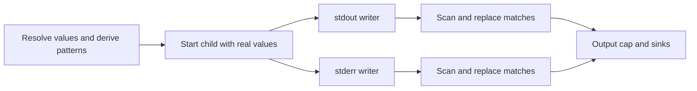

# Redaction algorithm and proof walkthrough

This guide follows the reviewed implementation and the paper's streaming
redaction section. The core result is **chunking invariance**: for a fixed
matcher, splitting the same byte stream into different `Write` calls produces
the same final output after `Flush`. Coverage depends on which patterns and
matching rules are registered. An attacker-controlled child can transform a
secret into an unsupported representation or disclose it through another channel.

All values below are synthetic. Source links are relative to the repository so
that this guide remains usable on GitHub.

## 1. Where the redactor sits

The execution layer resolves values before calling
[runner.Run](../internal/runner/runner.go). The runner registers the injected values and protected file contents, adds
supported encodings, and constructs a separate redacting writer for stdout and
stderr. Each writer sends its output through the configured output cap and sinks.
The child receives the real credentials. This filter controls the output streams
that pass through those writers.



The two writers do not combine their streams. A value deliberately split between
stdout and stderr is outside a single writer's pattern-matching guarantee.

## 2. Pattern registration

The production runner registers literal values of at least four bytes. For
values of at least eight bytes, it derives supported encodings and discards
candidate encodings shorter than eight bytes. Those are runner policy thresholds:
[redact.New](../internal/redact/redact.go) itself accepts any nonempty pattern.
Tests can therefore use shorter patterns to exercise the matching primitive.

[Encodings](../internal/redact/encodings.go) derives a finite collection:

- Standard and URL-safe base64, padded and unpadded, and alignment cores.
- Lowercase and uppercase hex.
- Selected Go, JavaScript, and Python URL-escaping styles, with upper/lowercase
  percent-escape digits.
- Selected JSON string-escaping forms.
- Selected second-level transforms of the first-level base64 and hex forms.
- Base64 wrapped at 64 or 76 columns.

This is a curated set rather than every possible composition. For example, the
implementation deliberately excludes URL-escaped first-level forms as inputs to
second-level derivation. A custom alphabet, reversal, encryption, or arbitrary
sequence of transforms can remain unrecognized.

## 3. The three matching tiers

At each position, [matchAt](../internal/redact/redact.go) tries these tiers in
order. It returns the number of input bytes to replace; zero means no match.

| Tier | Rule | Example |
| --- | --- | --- |
| Exact | Try patterns sharing the first byte, longest pattern first | `token=abc123` becomes `token=[REDACTED]` when `abc123` is registered |
| Gap-tolerant | Compare pattern bytes while skipping ASCII/control gap bytes in the pattern and output, within the global span limit | `a b\nc\t1\x0023` matches `abc123` |
| Fragment | Look up the next 12 non-gap bytes in an eligible long-pattern index, then extend forward along the indexed pattern | A partial printed segment of a long token or PEM value can be replaced |

Gap bytes are exactly bytes `0x00` through `0x20`, plus `0x7F`. The algorithm is
byte-based; these rules do not mean arbitrary Unicode whitespace is ignored.
Exact matching is case-sensitive. Registering upper/lowercase hex forms does not
make arbitrary secret matching case-insensitive.

Fragment indexing applies to patterns whose projection after removing gap bytes
has 24 through 65,536 bytes. Every 12-byte window of that projection is indexed.
A shorter original pattern may therefore have no fragment protection even though
its full value can be matched exactly or with gaps. This is why a 12-byte
password's partial disclosure can survive while longer token fragments are caught.

### Tier priority and overlaps

“Longest first” describes exact candidates; it does not choose the longest match
across all tiers. For registered patterns `abcd` and `abcdEFGHIJKL`:

```text
input:   abcdE F G H I J K L
output:  [REDACTED]E F G H I J K L
```

At the start, the shorter exact match wins before the longer gap-tolerant match
is tried. The longer pattern is too short for fragment indexing. Most of that
longer value remains recoverable. The output is still chunking-invariant: both
batch and chunked executions make the same priority decision.

Fragment windows can also collide between patterns or repeated positions. The
current index retains one `fragHit` per 12-byte key; forward extension follows
that entry. The proof assumes these indexes remain fixed during the comparison;
it does not establish globally maximal overlap coverage.

## 4. Why bytes must be held back

A process can print a secret across any number of writes:

```text
Write 1: token=abc
Write 2: 123\n
```

If `abc` were emitted immediately, the second write could not retract it. The
writer therefore keeps a suffix for which a future continuation could change a
match decision.

For a registered pattern set P, define:

```text
m = max({1} union {2 * byte_length(p) + 32 for p in P})
hold = m - 1
```

`m` is a global accepted match-span limit. Gap-tolerant matching uses this global
limit, not a different limit chosen separately for each candidate at runtime.
Fragment lookup and extension also stay within this window. Exact patterns are
shorter than `m`.

If the only pattern is the six-byte `abc123`, then `m = 44` and `hold = 43`:

| Step | Buffer before scanning | Emitted so far |
| --- | --- | --- |
| First write | `token=abc` (9 bytes) | Empty: insufficient lookahead |
| Second write | `token=abc123\n` (13 bytes) | Empty: still fewer than 44 bytes |
| Final flush | Complete 13-byte suffix | `token=[REDACTED]\n` |

Production encoding registration can increase `m`, so this is an illustrative
primitive-level example rather than a claim about the exact runner buffer size.

During an ordinary write, a position `i` is decidable only when:

```text
buffer_length - i >= m
```

A match starting there can consume bytes inside the held suffix: all of those
bytes are already present. The held suffix restricts where new decisions can
start, not which already-buffered bytes a decided match can consume.

After a successful scan, at most `m-1` undecided bytes remain. This bounds the
retained suffix between calls; it is not a bound on peak allocation while a
large write is appended, on total pattern-index memory, or on elapsed delay.
A quiet interactive process can leave a short prompt buffered indefinitely until
more bytes arrive or the stream is flushed.

For an empty pattern set, the paper's definition gives `m = 1` and zero
hold-back. The implementation stores `maxSpan == 0` but also uses zero hold-back,
so its behavior is equivalent: bytes pass through subject to the output cap.
The chunking result is immediate for that case.

## 5. Reading the scanner against the pseudocode

[scan](../internal/redact/redact.go) has two important variables:

- `safeEnd`: the first matched position, or the end of the safe unmatched prefix.
- `matchedLen`: the match found while the position was still inside the decidable
  region; zero if that scan found no match.

The scanner emits the safe unmatched prefix. If a match was found, it emits
`[REDACTED]`, consumes the matched span, and repeats. Otherwise it retains the
suffix and stops. On `Flush`, hold-back is set to zero because the complete
remaining suffix is available.

The paper's earlier pseudocode called `Match` again even after its search reached
the first held position. That position may have fewer than `m` buffered bytes,
so a short visible match could win before a longer match becomes visible. The
reviewed pseudocode now guards the extra call with `i < |B|-h`; the code already
saved `matchedLen` only inside the safe loop. The proof relies on this guard.

## 6. The proof, step by step

Fix the pattern set, candidate order, fragment indexes, and output cap. Assume
underlying writes consume the complete supplied output without errors. Compare:

```text
Batch:   Write(x); Flush()
Chunked: Write(x1); Write(x2); ...; Write(xk); Flush()
where x = x1 || x2 || ... || xk
```

There are no intermediate flushes and both receive the same byte order.

1. **Local decision bound.** At an ordinary scan decision, at least `m` bytes
   beginning at the current position are buffered. Every match decision depends
   only on that window. A later continuation cannot change the result.
2. **Same first decision.** The batch execution sees that same window. With the
   same fixed indexes and tier priority, both choose the same match span, or both
   decide that the current byte is unmatched.
3. **Same next state.** They emit the same bytes or placeholder and consume the
   same input. Their next undecided input position is therefore the same.
4. **Induction.** Repeat the previous argument for each subsequent decision.
5. **Final suffix.** Some positions lack `m` bytes of lookahead. Both executions
   defer them until they have enough bytes or until `Flush`. At final flush,
   the entire remaining suffix is present and both finish identically.

A fixed output cap preserves equality by taking the same prefix of identical
redacted output. The production runner enforces its cap downstream of redaction;
reaching a cap is not evidence that the underlying unredacted output was safe.

This proof establishes **the same result under different chunk boundaries**.
Recognizing every sensitive representation requires a separate coverage argument.
Equal outputs can contain the same missed transformation.

### Assumptions that change the conclusion

| Change | Consequence |
| --- | --- |
| Call `AddSecret` after bytes have been emitted | Earlier bytes cannot be retracted; registration timing becomes part of the behavior |
| Call `Flush` between pieces of a secret | A prefix can be emitted before its continuation arrives |
| Change the byte order with concurrent producers | That is a different input stream; the mutex makes operations safe, not order-independent |
| Underlying output sink fails | The successful-output theorem does not apply; callers must propagate the failure |
| Transform a value into an unregistered representation | Chunk boundaries remain harmless, but the transformed value can survive |

`AddSecret` is thread-safe, but thread safety is different from retroactive
coverage. Tests in [redact_addsecret_timing_test.go](../internal/redact/redact_addsecret_timing_test.go)
document this distinction. Register values before the child can emit them.

## 7. Why base64 needs alignment cores

Base64 groups three input bytes into four output characters. Encoding a secret
alone generally differs from encoding it inside `username:secret`, because the
prefix changes which secret bits share a base64 character with neighboring data.
There are three alignment cases: the secret begins at byte offset 0, 1, or 2
modulo 3.

For a secret `s` of `n` bytes, choose `k` leading dummy bytes for each alignment.
Keep only the base64 characters whose six bits come entirely from secret bytes:

```text
start = ceil(8*k / 6)
end   = floor(8*(k+n) / 6)        // exclusive
core  = base64(zero_bytes(k) || s)[start:end]
```

The dummy bytes can be zero because characters that depend on them are discarded.
The end bound similarly excludes any character needing bits from following data.
[Base64Cores](../internal/redact/encodings.go) derives these cores in the standard
and URL-safe alphabets. The runner's minimum derived-pattern length still applies.
Removing the core prevents recovery of that covered interior, but boundary
characters can retain some bits; this is not a proof of zero information leakage.

## 8. What the tests establish

[TestStreamingMatchesBatch](../internal/redact/shapes_test.go) constructs 3,000
deterministically randomized cases from fixed synthetic patterns and their
encodings. Inputs combine complete forms, partial fragments, gap-interleaved
forms, and noise. It compares a single-write-plus-flush output with writes split
into random 1–13-byte pieces followed by flush. This directly exercises the
paper's property on that corpus; it does not enumerate every input or partition.

Other focused tests cover:

- [Exact overlaps and prefix patterns](../internal/redact/redact_audit_test.go).
- [Gap/control-byte matching, fragment thresholds, and cross-write fragments](../internal/redact/redact_v2_test.go).
- [Base64 alignment, JSON/URL forms, and binary secret fragments](../internal/redact/shapes_test.go).
- [Fuzzed synthetic output](../internal/redact/fuzz_test.go), checked for surviving
  registered literals and long-pattern fragments under uneven chunking.
- [Final output-flush failures](../internal/runner/runner_test.go): stdout and
  stderr sink failures must be returned after both streams and secret cleanup
  are handled. This checks an error path outside the successful-write theorem.

A passing finite test suite supports the implementation argument. It does not
replace the stated assumptions, validate the whole security boundary, or make
the child information-flow secure.

## 9. How to read the evaluation alongside the proof

The [leakage reproduction](../paper/REPRODUCING.md) measures case-insensitive
contiguous recovery of at least half a synthetic credential after a decoder
battery. The runtime matcher itself is byte-exact apart from its specified gap
normalization and explicitly registered variants. These are different definitions
because the experiment asks how much an observer can recover, not simply whether
an exact literal remains.

The reproduced 52/126 versus 28/126 threshold counts, and 21/72 versus 3/72
accidental-subset counts, establish behavior on the selected corpus. A partial
URL-password component can be useful even when it is less than half the full
registered database URL. Interpret threshold misses as partial-disclosure
measurements, not a guarantee that every case below the threshold is safe.

Questions for the next reading session: which supported forms do target tools
actually print; how should overlap priority trade off disclosure and excess
masking; and which output-latency tradeoffs are acceptable for interactive tools?
Those choices affect coverage and usability without changing the core induction.
