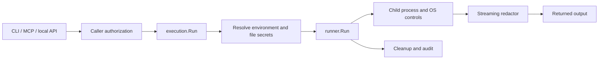

# Reverse-engineering review — October 20, 2026

## Tools actually used

- [REA](https://github.com/morluto/rea), npm `rea-agents@6.7.0`; source inspected at
  `1629266e3c08c90fed6bba5383528af7986a12b7`.
- [Graphify](https://github.com/Graphify-Labs/graphify), version 0.9.93, installed
  from source commit `b90b9df7949bd04a15b40a1624af85d0a9cfdf04` into a temporary
  virtual environment. Extraction used `--code-only --no-dedup`; no model backend.
- Primary-source web research: the cited [credential-leakage study, version 2](https://arxiv.org/html/2604.03070v2),
  and [1Password's CLI documentation](https://www.1password.dev/cli/reference/commands/run).

These were the likely projects identified by web search; the user was asked to
confirm the intended repositories and review priority. No answer was required
for the independent source review. Tool installations are temporary; no global
agent configuration, credentials, remote graph, or project dependency was changed.

## Graph evidence and limits

Final graph: **1819 nodes, 6429 relationships**, with
5980 tagged EXTRACTED and 449 tagged INFERRED.
Graphify used code-only extraction, skipping docs/PDFs for semantic extraction.
Five code-classified files yielded no symbols, including the npm entry point and
postinstall script. Large hubs such as `testing.T` and standard-library package
nodes reflect test/import connectivity; degree is not proof of security importance.
Community labels are automatic structural hints, not reviewed architecture names.

A useful extracted edge links `internal/execution/execution.go:194` to
`runner.Run`; caller tests and the paper harness also target this function. The
source confirms the following execution path (this diagram is manually reviewed,
not a claim that all runtime paths were dynamically observed):



Graph metadata names the base Git commit, but this review includes uncommitted
changes. Do not use the commit alone as the graph's complete provenance. Source
hashes are recorded alongside the raw outputs. Static graph links, including
EXTRACTED links, do not prove a path executes or an authorization property holds.

## REA evidence and limits

`inspect-go-binary` was refreshed on the October 21 four-platform snapshot's Linux amd64 ELF:
SHA-256 `fd6ceb9cd51e92337418763cff92be75f135bbf04c04bbc754262b06394f1d02`,
Go 1.26.9, 21,758,114 bytes. It includes the working-directory, final-flush, and
bounded-gap fixes. Signing, SBOM generation, before hooks and publication were
skipped for this local snapshot; it is not a signed release. The earlier
two-build reproducibility comparison used the prior source state.
REA extracted build metadata and dependencies, not a native-code decompilation
or dynamic security audit.

`analyze-javascript-application` inspected 12 relevant files,
parsed 10 JavaScript files, and reported
0 parse failures and no integrity contradictions.
Its 122 structural observations are **not vulnerability findings**.
REA read inert source; it did not execute launcher bootstrap code. Its reported
complete inventory coverage does not establish complete runtime behavior coverage.

## Confirmed fix: relative executable resolution

Before: `runner.Run` called `exec.LookPath("./greet")` in the host's current
working directory, then set the child's project directory. CLI/MCP calls from
outside the project therefore failed even when the approved project-local
executable existed.

After: the runner computes the effective child directory first and resolves an
explicit relative executable against it. Bare executable names retain PATH
lookup. The same effective directory is assigned to the child.

Three regression cases failed before the fix and passed afterward: project root,
relative command workdir, and absolute command workdir. The full `go test -race
./...` suite and `go vet ./...` passed after the change.

## Primary-source corrections

The credential-leakage study reports 17,022 sampled skills and describes the
73.5% statistic as 1,007 of 1,371 vulnerability issues. It is not a population-wide
rate of credential leakage across agents. The manuscript now states that
scope and pins the reference to version 2. This check verifies the citation's
reported claim, not the study's underlying data or statistical validity.

1Password documents that `op run` conceals stdout/stderr secrets by default and
provides `--no-masking` to disable it. Ironrun's already-corrected comparison is
supported by the primary documentation; redaction alone is not a unique feature.

## Reproduction

```sh
graphify extract /path/to/ironrun --code-only --no-dedup --out /path/to/analysis
graphify cluster-only /path/to/analysis
rea inspect-go-binary /path/to/snapshot/ironrun --json > rea-go-binary.json
rea analyze-javascript-application /path/to/ironrun/npm --json > rea-npm.json
```

Raw outputs and interactive graph live in `/workspace/ironrun-analysis/` in this
workspace. They are intentionally outside the source repository. New code changes
require a refreshed graph and rebuilt binary; previous snapshot hashes do not
prove the final source state. Live release, platform and human gates in
`LAUNCH_READINESS.md` remain open.
