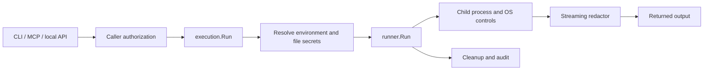

# Reverse-engineering review — October 21, 2026

Refreshed on clean source commit `803aa420d35af969ca4ff858a374a7dcdf20796d`.
The subsequent paper/documentation correction does not alter runtime source.
Compact evidence and primary-source research are in
[source-followup](validation/2026-10-21/source-followup/README.md).

## Tools actually used

- [REA](https://github.com/morluto/rea), npm `rea-agents@6.7.0`; source inspected at
  `1629266e3c08c90fed6bba5383528af7986a12b7`.
- [Graphify](https://github.com/Graphify-Labs/graphify), version 0.9.93, installed
  from source commit `b90b9df7949bd04a15b40a1624af85d0a9cfdf04` into a temporary
  virtual environment. Extraction used `--code-only --no-dedup`; no model backend.
- Primary-source web research: the cited [credential-leakage study, version 2](https://arxiv.org/html/2604.03070v2),
  and [1Password's CLI documentation](https://www.1password.dev/cli/reference/commands/run).

These were the likely projects identified by web search; the user was asked to
confirm the intended repositories and review priority. No answer was required
for the independent source review. Tool installations are temporary; no global
agent configuration, credentials, remote graph, or project dependency was changed.

## Graph evidence and limits

Refreshed graph: **1849 nodes, 6593 raw relationships**, with
6139 tagged EXTRACTED and 454 tagged INFERRED. Clustering yields 73 communities
and 6564 unique undirected endpoint pairs. The earlier graph had 1840 nodes and
6474 pairs; comparable pair growth is 90. Raw-link growth also includes a change
from a simple graph to a multigraph, so it is not an architecture-growth measure.
Graphify used code-only extraction, skipping docs/PDFs for semantic extraction.
Five code-classified files yielded no symbols, including the npm entry point and
postinstall script. Large hubs such as `testing.T` and standard-library package
nodes reflect test/import connectivity; degree is not proof of security importance.
Community labels are automatic structural hints, not reviewed architecture names.

A useful extracted edge links `internal/execution/execution.go:194` to
`runner.Run`; caller tests and the paper harness also target this function. The
source confirms the following execution path (this diagram is manually reviewed,
not a claim that all runtime paths were dynamically observed):



The current graph JSON does not embed the source commit. Separate provenance
records the clean HEAD/tree, exact commands, source hashes and artifact hashes.
The earlier graph included uncommitted repairs and retains its original scope.
Static graph links, including
EXTRACTED links, do not prove a path executes or an authorization property holds.
Manual checks traced npm verification/spawn, proposal/approval/policy execution,
and runner/redactor wiring. The graph omits important signal-callback ordering,
function-variable aliases, and implicit writer data flow; those require source
review and separate tests. The generated HTML loads vis-network from unpkg.com
when viewed; extraction and clustering used no model backend.

## REA evidence and limits

`inspect-go-binary` inspected a fresh Linux amd64 build from clean `803aa42`:
SHA-256 `87e01d39496885e1ad284e520f0363710765e1c6f35399c76dbd03faa1e5e056`,
Go 1.26.10, 31,008,898 bytes. REA and `go version -m` agree on revision,
`vcs.modified=false`, `CGO_ENABLED=0`, and `-trimpath`. This development build
omits release stripping/stamping, signing and SBOM generation. Its hash is not a
direct comparison with the earlier stripped snapshot or historical public release.
Earlier snapshot/repeated-build evidence remains in `docs/validation/2026-10-21/`.
REA extracted build metadata and dependencies, not a native-code decompilation
or dynamic security audit.

`analyze-javascript-application` inspected 13 relevant files,
parsed 11 JavaScript files, and reported
0 parse failures and no integrity contradictions.
Its 153 structural observations are **not vulnerability findings**.
REA read inert source; it did not execute launcher bootstrap code. Its reported
application coverage is partial and semantic coverage is unknown, with 1,628
explicit unknowns. Neither inventory consistency nor those counts establish
runtime correctness. The actual publication validator still rejects the
intentionally unprepared bootstrap manifest, as designed.

## Confirmed fix: relative executable resolution

Before: `runner.Run` called `exec.LookPath("./greet")` in the host's current
working directory, then set the child's project directory. CLI/MCP calls from
outside the project therefore failed even when the approved project-local
executable existed.

After: the runner computes the effective child directory first and resolves an
explicit relative executable against it. Bare executable names retain PATH
lookup. The same effective directory is assigned to the child.

Three regression cases failed before the fix and passed afterward: project root,
relative command workdir, and absolute command workdir. The full `go test -race
./...` suite and `go vet ./...` passed after the change.

## Primary-source corrections

The credential-leakage study reports 17,022 sampled skills and describes the
73.5% statistic as 1,007 of 1,371 vulnerability issues. It is not a population-wide
rate of credential leakage across agents. The manuscript now states that
scope and pins the reference to version 2. This check verifies the citation's
reported claim, not the study's underlying data or statistical validity.

1Password documents that `op run` conceals stdout/stderr secrets by default and
provides `--no-masking` to disable it. Ironrun's already-corrected comparison is
supported by the primary documentation; redaction alone is not a unique feature.
The official 2.40.0 release notes also call its masking best effort. Current
fnox documentation includes tool/secret allowlists, while Prismor documents
command policy and human approval alongside output filtering. The manuscript
now acknowledges that overlap and removes broad missing-design/firstness wording.
These current sources do not establish when competing features became available.
Official arXiv instructions still impose the 1,920-character abstract limit and
accept either complete `.bib` input or a matching prebuilt `.bbl`; this bundle
includes both. Primary-source URLs and evidence limits are recorded in the
linked follow-up.

## Reproduction

```sh
graphify extract /path/to/ironrun --code-only --no-dedup --no-cluster --out /path/to/analysis
graphify cluster-only /path/to/analysis --no-label
rea inspect-go-binary /path/to/snapshot/ironrun --json > rea-go-binary.json
rea analyze-javascript-application /path/to/ironrun/npm --json > rea-npm.json
```

Raw outputs and interactive graph live in `/workspace/ironrun-analysis/` in this
workspace. They are intentionally outside the source repository. New code changes
require a refreshed graph and rebuilt binary; previous snapshot hashes do not
prove the final source state. Live release, platform and human gates in
`LAUNCH_READINESS.md` remain open.
